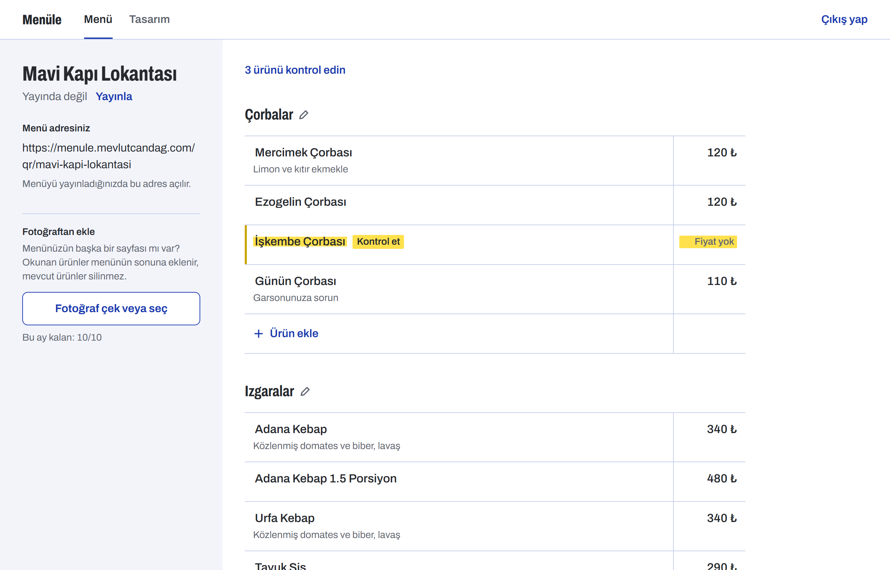
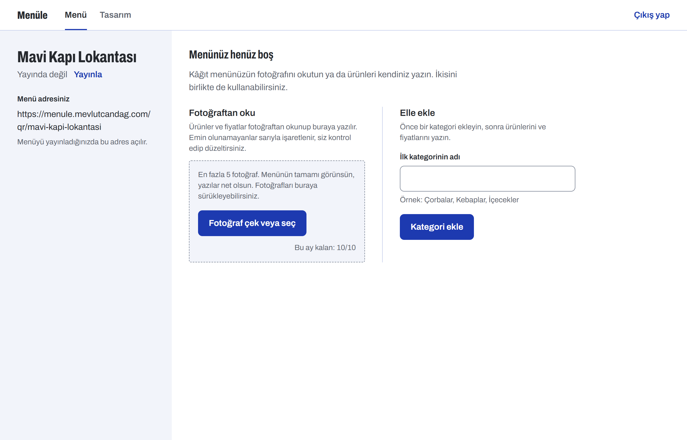
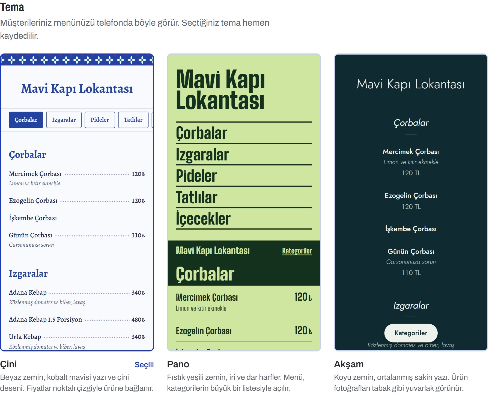
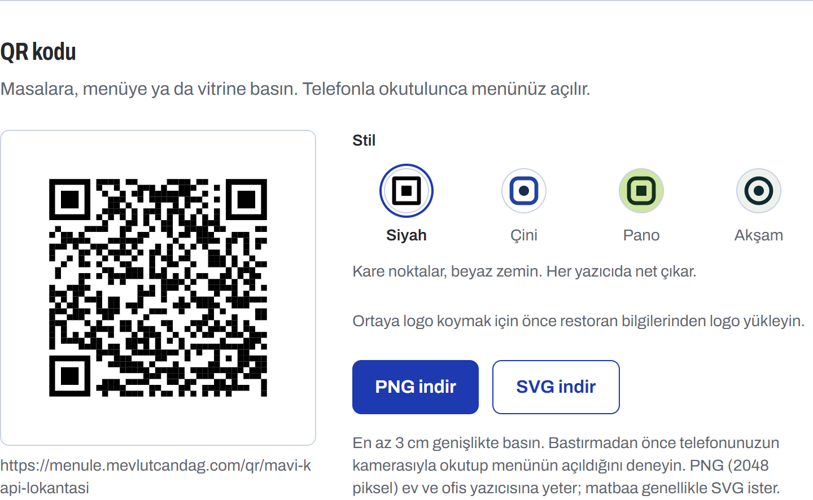
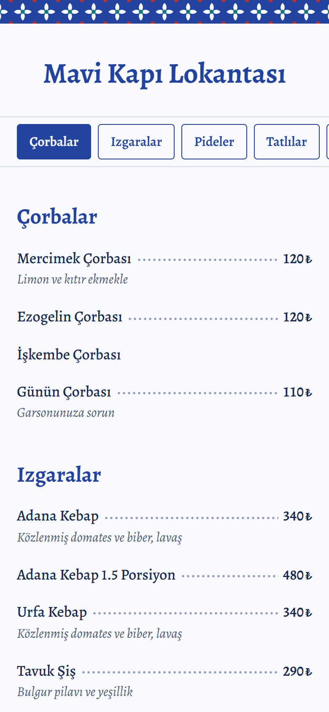
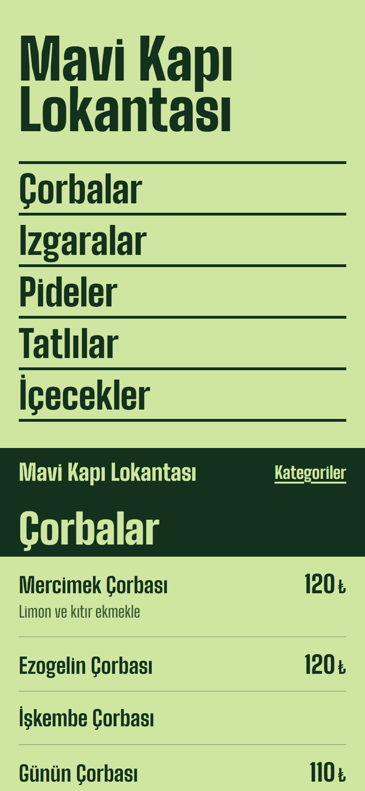
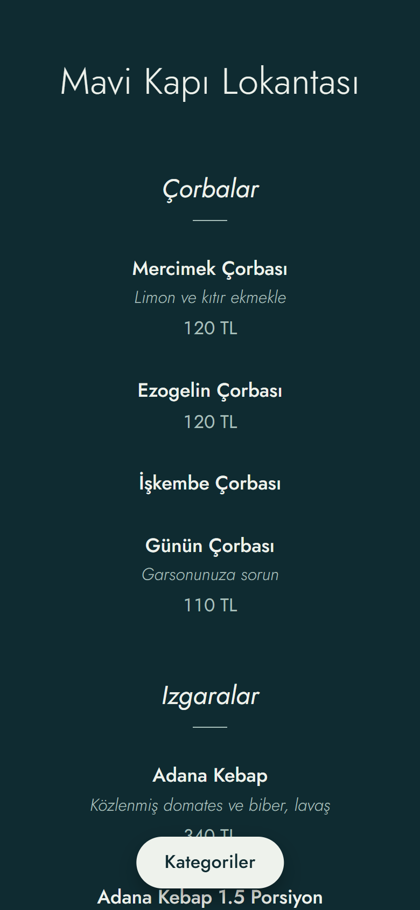
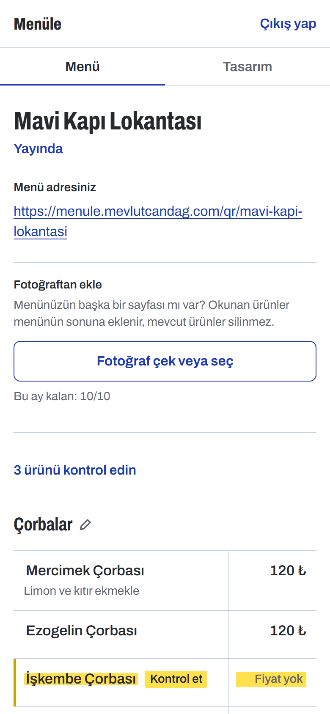

# Menüle

Restoranlar için QR menü. Kâğıt menünün fotoğrafını çekin; ürünler ve fiyatlar okunur, emin olunamayanlar sarıyla işaretlenir. Siz kontrol edip yayınlarsınız, müşterileriniz QR kodu okutunca menü telefonlarında açılır.

**Canlı:** https://menule.mevlutcandag.com



## Nasıl çalışır

### 1. Menünün fotoğrafını çekin

Telefonla çekin ya da galeriden seçin, tek seferde en fazla 5 fotoğraf. Fotoğraf şart değil: menü kategorilerle elle de yazılabilir. Boş panel iki yolu yan yana sunar.



### 2. Sarı işaretlileri kontrol edin

Okunan ürünler kategorileriyle düzenleme ekranına yazılır. Okunamayan fiyatlar boş bırakılır, emin olunamayan ürünler fosforlu kalemle işaretlenir. Okuma mevcut menüyü silmez, ürünleri sona ekler.


### 3. Tema seçin

Menü üç temada yan yana önizlenir. Seçilen tema hemen kaydedilir.



### 4. QR kodu basın

Dört stil, ortada isteğe bağlı logo. PNG (2048 piksel) veya SVG olarak indirilir. QR kod tamamen tarayıcıda üretilir, sunucuda saklanmaz.



## Müşterinin gördüğü menü

`/qr/{slug}` adresi, sunucuda render edilir (SSR), uygulama veya üyelik gerektirmez.

| Çini | Pano | Akşam |
|---|---|---|
|  |  |  |

## Özellikler

- **Fotoğraftan okuma:** ürün, açıklama, fiyat ve kategori. Porsiyon farkı ayrı satır olur ("Adana 1.5 Porsiyon"). Adres, telefon, wifi şifresi gibi menü dışı yazılar atlanır. Görsel menü değilse reddedilir.
- **Uydurma yok:** okunamayan fiyat `null`, emin olunmayan ürün `uncertain` olarak işaretlenir.
- **Düzenleme:** kategori ve ürün ekleme, silme, sıralama, ürünü başka kategoriye taşıma, ürün fotoğrafı.
- **Logo:** menünün başında ve isteğe bağlı olarak QR kodun ortasında.
- **Sabit adres:** slug restoran adından üretilir ve yayınlandıktan sonra değişmez, basılı QR kodlar bozulmaz.
- **Limit:** restoran başına takvim ayında 10 fotoğraf okuma. Elle düzenlemenin sınırı yok.
- **Telefonda tam çalışan panel.**



## Teknik yapı

| Klasör | |
|---|---|
| `backend/` | Laravel, yalnızca API. Sanctum (SPA cookie), PostgreSQL, `database` kuyruk sürücüsü, `public` disk. |
| `frontend/` | Nuxt 4, TypeScript, Tailwind 4, Pinia ORM. `/qr/[slug]` SSR. QR: `qr-code-styling`. |
| `docker/` | Yerel geliştirme imajı (PHP 8.4 CLI). |

Menü okuma akışı: tarayıcı fotoğrafı küçültür (uzun kenar 2000px, JPEG) → `POST /api/menu-imports` → `ReadMenuJob` → `MenuReader` (Anthropic Messages API, tüm fotoğraflar tek istekte, structured output) → Laravel Validator → `categories` ve `items` tablolarına yazma. Frontend 2 saniyede bir `GET /api/menu-imports/{id}` ile durumu sorar. Geçersiz yanıt bir kez tekrar denenir.

### Veri modeli

| Tablo | Alanlar |
|---|---|
| `restaurants` | user_id, name, slug (unique), theme, logo_path, published_at |
| `categories` | restaurant_id, name, sort_order |
| `items` | category_id, name, description, price, image_path, uncertain, sort_order |
| `menu_imports` | restaurant_id, image_paths, image_count, status, error |

## Yerel geliştirme

Gerekenler: Docker, Node 22.

```bash
# Backend: PostgreSQL, API (localhost:8000) ve kuyruk worker'ı
cp backend/.env.example backend/.env
# backend/.env içinde:
#   DB_CONNECTION=pgsql  DB_HOST=db  DB_PORT=5432  DB_DATABASE=qr  DB_USERNAME=qr  DB_PASSWORD=qr_local
#   SESSION_DOMAIN=localhost  ANTHROPIC_API_KEY=...
docker compose up -d
docker compose exec app composer install
docker compose exec app php artisan key:generate
docker compose exec app php artisan migrate
docker compose exec app php artisan storage:link

# Frontend (localhost:3000)
cd frontend
npm install
npm run dev
```

Menü okumayı arayüz olmadan denemek için:

```bash
docker compose exec app php artisan menu:read storage/app/ornek1.jpg storage/app/ornek2.jpg
```

## Deploy (Coolify)

Backend ve frontend aynı repodan iki ayrı Dockerfile uygulaması olarak çalışır.

| Servis | Base directory | Port | Domain |
|---|---|---|---|
| Backend | `/backend` | 80 | `api.menule.mevlutcandag.com` |
| Frontend | `/frontend` | 3000 | `menule.mevlutcandag.com` |
| PostgreSQL | | | Coolify veritabanı |

- Backend imajı tek container: nginx + php-fpm + `queue:work` (supervisord). Açılışta `config:cache`, `route:cache`, `migrate --force`, `storage:link` çalışır.
- `/var/www/html/storage/app` kalıcı volume olarak bağlanmalı (ürün görselleri, logolar, menü fotoğrafları).
- Sanctum cookie için iki servis aynı ana alan adı altında olmalı: `SESSION_DOMAIN=.menule.mevlutcandag.com`, `SANCTUM_STATEFUL_DOMAINS=menule.mevlutcandag.com`, `FRONTEND_URL=https://menule.mevlutcandag.com`.
- Frontend: `NUXT_PUBLIC_API_BASE` ve `NUXT_PUBLIC_SITE_URL` çalışma anında okunur.
